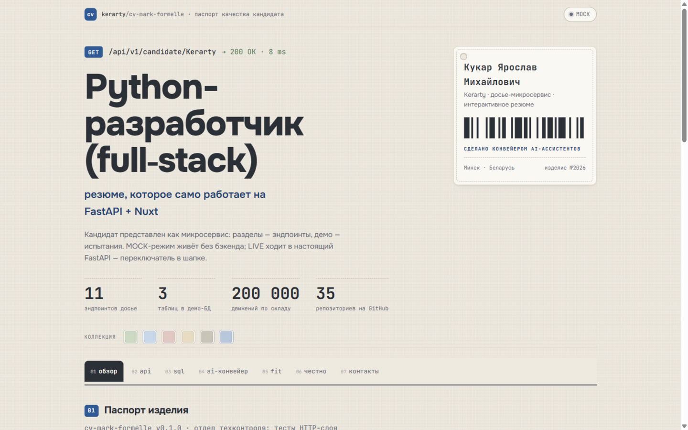

# cv-mark-formelle — досье кандидата как микросервис

[](https://github.com/Kerarty/cv-mark-formelle/actions/workflows/ci.yml)

**Кукар Ярослав Михайлович** ([Kerarty](https://github.com/Kerarty)) — интерактивное резюме
для вакансии **Python-разработчик (Full-stack)** в отдел по развитию ИИ
[Марк Формэль](https://rabota.by/vacancy/139486046?hhtmFrom=favorites).

**Смотреть:** [kerarty.github.io/cv-mark-formelle](https://kerarty.github.io/cv-mark-formelle/)



## Идея

Вакансия просит FastAPI, Nuxt и SQL — поэтому резюме собрано как **работающий
микросервис**, а не как список навыков: страница — дашборд, разделы — эндпоинты,
SQL-демо — лабораторные испытания на живых данных. Дизайн — «паспорт качества
изделия»: бирка, строчка, штрих-код — в айдентике мира Марк Формэль.

Форма отвечает содержанию: навык «ежедневная работа с AI-ассистентами» показан
самим досье — оно собрано открытым конвейером (правила, контракты-тесты, проверка
фактов), как и [23 резюме-проекта серии cv-* за ~7 недель](https://github.com/Kerarty?tab=repositories).

## Что внутри

| Таб | Что показывает |
|---|---|
| [обзор](https://kerarty.github.io/cv-mark-formelle/#overview) | паспорт кандидата: опыт-хронология, 6 репозиториев-изделий |
| [api](https://kerarty.github.io/cv-mark-formelle/#api) | 11 эндпоинтов досье, клик по строке выполняет реальный запрос с латентностью |
| [sql](https://kerarty.github.io/cv-mark-formelle/#sql) | демо-схема ритейла на 200 000 строк: план до/после индекса, уровни изоляции в T-SQL |
| [ai-конвейер](https://kerarty.github.io/cv-mark-formelle/#ai) | как это резюме собрано ассистентами: правила → контракты-тесты → проверка |
| [fit](https://kerarty.github.io/cv-mark-formelle/#fit) | маппинг требований вакансии на доказательства: ✓ есть / ◐ частично / ○ план |
| [честно](https://kerarty.github.io/cv-mark-formelle/#honest) | чего пока нет — написано прямо |
| [контакты](https://kerarty.github.io/cv-mark-formelle/#contact) | этикетка изделия: контакты и бот записи на собеседование |

Каждый таб открывается по прямой ссылке; есть noscript-версия, print-стили и
поддержка `prefers-reduced-motion` — HR нельзя проиграть.

## Двухрежимный API

- **MOCK (по умолчанию)** — страница на GitHub Pages работает без бэкенда:
  мок-слой отвечает теми же JSON-контрактами, что и FastAPI.
- **LIVE (опция)** — переключатель направляет запросы в реальный FastAPI
  (`docker compose up`). Если бэкенд недоступен — тихий fallback в MOCK
  с честным бейджем.

## SQL-демо

SQLite-зеркало склада ритейлера: 3 таблицы, 200 000 движений. Прогон
«Отчёт по отгрузкам за 3 дня» измеряет латентность до и после составного
индекса и показывает честные планы:

- без индекса — `SCAN m` + temp B-tree;
- с индексом — `SEARCH m USING INDEX idx_movements_status_date`;
- измеренное ускорение — **×8.6 и ×28.5** на двух запросах.

Транзакции и уровни изоляции разобраны на сценариях остатков склада
(lost update, non-repeatable read, phantom read, deadlock) в T-SQL.

## Структура репозитория

```
backend/
  app/
    main.py            # FastAPI-приложение
    content.py         # единственный источник контента резюме
    schemas.py         # Pydantic v2 — зеркала API-контрактов
    retail_db.py       # SQLite-демо на 200k строк
    routers/           # candidate, sql_demo
  tests/               # 13 тестов публичного HTTP-слоя (TestClient)
frontend/
  app/
    components/        # табы дашборда (Nuxt 3, SSG)
    data/mock.ts       # мок-слой: зеркала ответов бэкенда
    assets/css/        # дизайн-система «паспорт качества»
docker-compose.yml     # api + redis
.github/workflows/     # CI: ruff + pytest → generate → Pages
```

## Запуск

```bash
# бэкенд (Swagger: http://127.0.0.1:8000/docs)
cd backend
pip install -e ".[dev]"
uvicorn app.main:app --reload
pytest                              # тесты HTTP-слоя
ruff check . && ruff format --check .

# фронтенд
cd frontend
npm ci
npm run dev                         # http://localhost:3000
npm run generate                    # статический вывод в .output/public

# полный стек (api + redis)
docker compose up
```

## CI/CD

Пуш в `main` → GitHub Actions: ruff + pytest → `npm ci && npm run generate` →
деплой на GitHub Pages. Правила работы агентов с репозиторием — в
[AGENTS.md](AGENTS.md).

## Честность

- Маппинг требований ✓/◐/○: единственный ✓ — ежедневная работа с AI-ассистентами;
  SQL, Python, FastAPI, Nuxt — ◐ с указанием, что именно показано.
- Коммерческого опыта разработки нет — Python это университетский курс плюс
  self-study; это написано прямо в [табе «честно»](https://kerarty.github.io/cv-mark-formelle/#honest).
- Каждый числовой факт проверяем по [github.com/Kerarty](https://github.com/Kerarty):
  35 публичных репозиториев, даты создания cv-* проектов — через api.github.com.

## Контакты

**GitHub:** [github.com/Kerarty](https://github.com/Kerarty) ·
**Telegram:** [t.me/Kerarty](https://t.me/Kerarty) ·
**Email:** kukar.yar@gmail.com ·
**Телефон:** +375 44 783-84-89

Запись на собеседование — через Telegram-бот компании:
[t.me/recruit_markformelle_bot](https://t.me/recruit_markformelle_bot)
